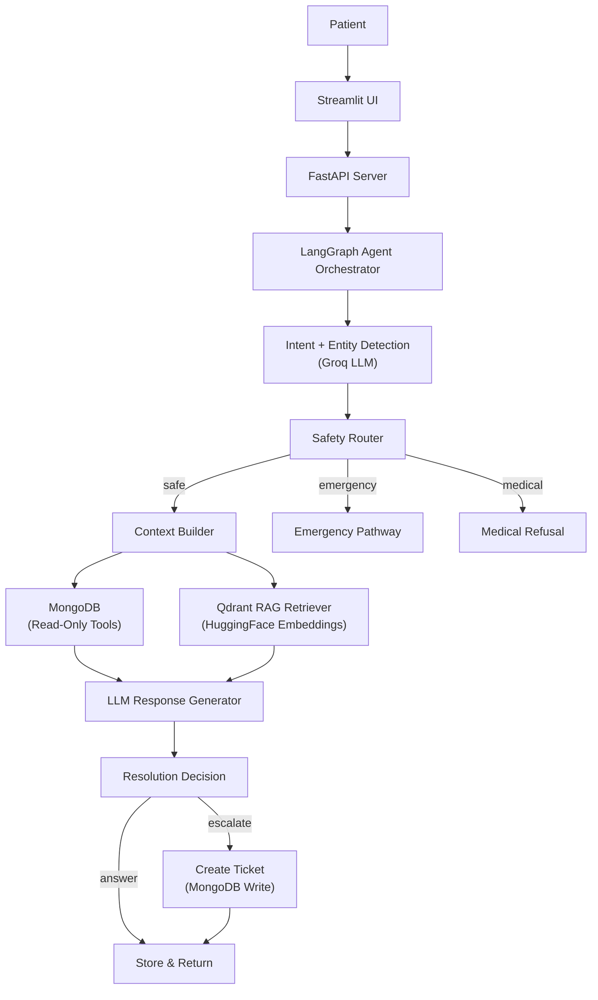

## HealthAssist AI Support Agent

An AI-powered customer support and resolution agent for a healthcare quick doctor-patient connection platform. Built as a standalone MVP demonstrating intelligent support with MongoDB context awareness, Qdrant RAG knowledge retrieval, and LangGraph agent orchestration.

## Architecture



## Why MongoDB?

- **Operational data store**: Users, doctors, consultations, payments, and support tickets are document-oriented data that maps naturally to MongoDB.
- **Future MERN integration**: The production app will use MongoDB via a MERN backend. This MVP uses the same database to demonstrate the integration path.
- **Flexible schema**: Healthcare platform data evolves rapidly; MongoDB's flexible schemas accommodate this.

## Why Qdrant?

- **Dedicated vector search**: While MongoDB supports vector search, this MVP demonstrates proper separation of concerns with a dedicated vector database.
- **Metadata filtering**: Qdrant's payload filtering allows category-based knowledge retrieval (e.g., only "payment" policies for payment queries).
- **Scalability**: In production, the knowledge base will grow; Qdrant handles this efficiently.

## RAG Pipeline

```
Knowledge Base (Markdown) → Document Loader → Text Cleaning → Paragraph-Based Chunking (500 chars, 100 overlap) → HuggingFace Embeddings (all-MiniLM-L6-v2, 384-dim) → Qdrant Vector Store
```

At query time:
```
User Query → Query Embedding → Qdrant Similarity Search (cosine, top-5) → Metadata Filtering → Relevance Threshold → Formatted Context for LLM
```

## Agent Workflow (LangGraph)

The agent follows a deterministic state machine:

1. **Classify Intent** — LLM structured output with 22 intents
2. **Safety Check** — Route emergencies, medical advice, adverse events
3. **Build Context** — Fetch relevant MongoDB data based on intent
4. **Retrieve Knowledge** — Qdrant RAG with category filtering
5. **Generate Response** — Grounded LLM response with all context
6. **Resolution Decision** — Deterministic escalation rules
7. **Escalate** — Create support ticket if needed
8. **Store Message** — Persist to MongoDB

## Escalation Rules

The system escalates when:
- Emergency signal detected
- Potential adverse event reported
- User explicitly requests human support
- Intent confidence below threshold (default: 0.60)
- No relevant knowledge found for knowledge-dependent queries
- Payment + failed consultation (requires refund review)
- Doctor didn't join a paid consultation
- Intent classified as "unknown"

## Database Schema

| Collection | Purpose | Records |
|---|---|---|
| `users` | Patient information | 15 demo patients |
| `doctors` | Doctor profiles | 7 demo doctors |
| `consultations` | Consultation sessions | 8 scenarios |
| `payments` | Payment records | 8 records |
| `user_activity` | User platform events | 18 events |
| `support_conversations` | Chat sessions | Dynamic |
| `support_messages` | Chat messages | Dynamic |
| `support_tickets` | Escalation tickets | Dynamic |

## API Endpoints

| Method | Endpoint | Description |
|---|---|---|
| `POST` | `/api/chat` | Main chat — runs full agent pipeline |
| `GET` | `/api/conversations/{id}` | Retrieve conversation + messages |
| `POST` | `/api/tickets` | Create support ticket |
| `GET` | `/api/tickets/{id}` | Retrieve ticket details |
| `GET` | `/health` | Health check (MongoDB + Qdrant) |
| `GET` | `/api/demo/users` | List demo patients |
| `GET` | `/api/demo/users/{id}` | Get patient details |

## Setup Instructions

### Prerequisites
- Python 3.11+
- Docker & Docker Compose
- Groq API key ([groq.com](https://groq.com))
- HuggingFace API key ([huggingface.co](https://huggingface.co))

### 1. Clone and Configure

```bash
# Copy environment file
cp .env.example .env

# Edit .env and add your API keys:
# GROQ_API_KEY=your_groq_api_key
# HUGGINGFACE_API_KEY=your_hf_api_key
```

### 2. Start Infrastructure

```bash
docker compose up -d
```

### 3. Setup Virtual Environment & Install Dependencies

```bash
# Create virtual environment
python -m venv venv

# Activate virtual environment (Windows)
venv\Scripts\activate
# Or on Mac/Linux:
# source venv/bin/activate

# Install dependencies
pip install -r requirements.txt
```

### 4. Seed Demo Data

```bash
python scripts/seed_demo_data.py
```

### 5. Ingest Knowledge Base

```bash
python scripts/ingest_knowledge.py
```

### 6. Start FastAPI Server

```bash
uvicorn app.main:app --reload --port 8000
```

### 7. Start Streamlit UI

```bash
streamlit run streamlit_app.py
```

### 8. Open the Demo

Navigate to `http://localhost:8501` in your browser.

## Environment Variables

| Variable | Default | Description |
|---|---|---|
| `MONGODB_URI` | `mongodb://localhost:27017` | MongoDB connection |
| `MONGODB_DATABASE` | `ha_customer_support` | Database name |
| `QDRANT_URL` | `http://localhost:6333` | Qdrant server |
| `GROQ_API_KEY` | — | Groq API key (required) |
| `LLM_MODEL` | `llama-3.3-70b-versatile` | Groq model |
| `HUGGINGFACE_API_KEY` | — | HF API key (required) |
| `EMBEDDING_MODEL` | `sentence-transformers/all-MiniLM-L6-v2` | Embedding model |
| `INTENT_CONFIDENCE_THRESHOLD` | `0.60` | Min confidence |
| `RAG_RELEVANCE_THRESHOLD` | `0.45` | Min similarity score |

## Demo Scenarios

| # | User | Query | Expected Behavior |
|---|---|---|---|
| 1 | Ananya Singh (U1004) | "How do I cancel a consultation?" | RAG answer, no ticket |
| 2 | Sourav Kumar (U1001) | "Where is my doctor?" | MongoDB context + answer |
| 3 | Sourav Kumar (U1001) | "I paid 499 but doctor didn't join" | Full pipeline + escalation + ticket |
| 4 | Kavita Iyer (U1010) | "Can I get 50,000 compensation?" | Escalation + ticket |
| 5 | Neha Sharma (U1008) | "What medicine should I take for fever?" | Medical refusal |
| 6 | Arjun Das (U1009) | "Severe chest pain and difficulty breathing" | Emergency escalation |

## Testing

```bash
# Run all tests
python -m pytest tests/ -v

# Run evaluation
python evals/evaluate.py
```

## Future Production Integration

```
Current MVP:                    Future Production:
Streamlit UI                    Flutter App
    |                               |
FastAPI                         MERN Backend (Express.js)
    |                               |
Python AI Service               Python AI Service (same)
    |                               |
MongoDB (demo data)             Production MongoDB (via MERN APIs)
Qdrant (local)                  Qdrant (managed/self-hosted)
```

The Python AI service is designed with clean interfaces so:
- `tools/` functions can be replaced with MERN API clients
- `TicketService` can call MERN ticket endpoints instead of direct MongoDB
- `ContextBuilder` can fetch data from MERN APIs
- Agent logic (LangGraph, LLM, RAG) remains unchanged

## Tech Stack

| Component | Technology |
|---|---|
| LLM | Groq (llama-3.3-70b-versatile) |
| Agent Orchestration | LangChain + LangGraph |
| Embeddings | HuggingFace (all-MiniLM-L6-v2) |
| Vector DB | Qdrant |
| Operational DB | MongoDB |
| API | FastAPI |
| UI | Streamlit |
| Validation | Pydantic |
