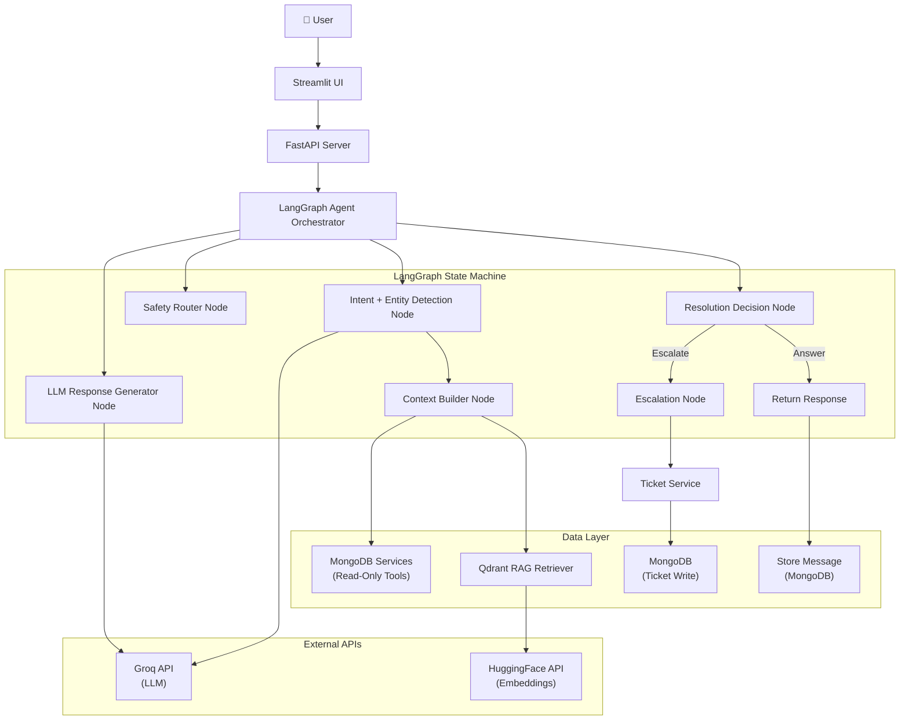
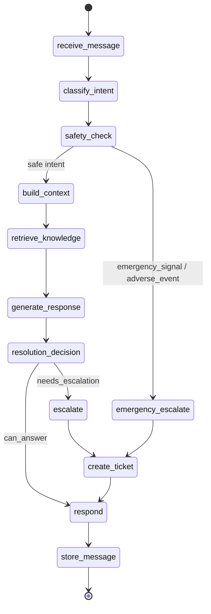

# AI Healthcare Customer Support & Resolution Agent — Implementation Plan

## Overview

Build a standalone MVP/demo of an AI customer support agent for a healthcare quick doctor-patient connection platform. The system combines **MongoDB** (operational context), **Qdrant** (RAG knowledge retrieval), **Groq LLM** (reasoning), **LangChain + LangGraph** (agent orchestration), and **HuggingFace Sentence Transformers** (embeddings) to demonstrate intelligent, context-aware customer support with human escalation.

---

## Technology Decisions

| Component | Technology | Rationale |
|---|---|---|
| **LLM** | Groq API (`llama-3.3-70b-versatile`) | Fast inference, structured output, configurable via env vars |
| **Embeddings** | HuggingFace Sentence Transformers (`all-MiniLM-L6-v2`) via API | Free, high-quality embeddings, 384-dim vectors |
| **Agent Orchestration** | LangChain + LangGraph | State machine workflow, observable traces, tool integration |
| **Vector DB** | Qdrant | Dedicated vector search with metadata filtering |
| **Operational DB** | MongoDB | Document store for users, consultations, payments, tickets |
| **API** | FastAPI | Async, Pydantic integration, auto-docs |
| **UI** | Streamlit | Rapid demo UI with sidebar + chat layout |
| **Containerization** | Docker Compose | MongoDB + Qdrant local setup |

---

## Architecture Diagram



---

## LangGraph Agent State Machine



### LangGraph State Schema

```python
class AgentState(TypedDict):
    # Input
    user_id: str
    conversation_id: str
    user_message: str
    message_history: list[dict]
    
    # Intent & Entities
    intent_result: Optional[IntentResult]
    
    # Context
    user_context: Optional[dict]
    mongodb_context: Optional[dict]
    rag_results: Optional[list[dict]]
    
    # Safety
    safety_classification: Optional[str]  # "safe" | "medical_advice" | "emergency"
    
    # Response
    llm_response: Optional[str]
    should_escalate: bool
    escalation_reason: Optional[str]
    
    # Ticket
    ticket_id: Optional[str]
    ticket_created: bool
    
    # Trace
    trace_events: list[dict]
    
    # Error
    error: Optional[str]
```

---

## Project Structure

```
c:\Users\ASUS\HA_CustomerSupport\
│
├── app/
│   ├── __init__.py
│   ├── main.py                        # FastAPI application entry
│   ├── config.py                      # Centralized settings (Pydantic BaseSettings)
│   │
│   ├── api/
│   │   ├── __init__.py
│   │   ├── chat.py                    # POST /api/chat
│   │   ├── tickets.py                 # POST /api/tickets, GET /api/tickets/{id}
│   │   ├── health.py                  # GET /health
│   │   └── demo.py                    # GET /api/demo/users, GET /api/demo/users/{id}
│   │
│   ├── agent/
│   │   ├── __init__.py
│   │   ├── orchestrator.py            # LangGraph workflow definition
│   │   ├── nodes.py                   # LangGraph node functions
│   │   ├── state.py                   # AgentState TypedDict
│   │   └── prompts.py                 # All LLM prompt templates
│   │
│   ├── classification/
│   │   ├── __init__.py
│   │   ├── intent.py                  # LLM-based intent classifier
│   │   └── schemas.py                 # IntentResult, Entity Pydantic models
│   │
│   ├── context/
│   │   ├── __init__.py
│   │   └── builder.py                 # Context builder (intent-aware retrieval)
│   │
│   ├── rag/
│   │   ├── __init__.py
│   │   ├── ingestion.py               # Document loading, chunking, embedding
│   │   ├── retriever.py               # Qdrant similarity search
│   │   └── embeddings.py              # HuggingFace Sentence Transformer client
│   │
│   ├── tools/
│   │   ├── __init__.py
│   │   ├── user.py                    # get_user_context(user_id)
│   │   ├── consultation.py            # get_active_consultation(user_id)
│   │   ├── payment.py                 # get_payment_status(consultation_id)
│   │   ├── activity.py                # get_user_activity(user_id)
│   │   └── ticket.py                  # create_support_ticket(ticket_data)
│   │
│   ├── db/
│   │   ├── __init__.py
│   │   ├── mongodb.py                 # MongoDB connection + collection accessors
│   │   └── qdrant.py                  # Qdrant client wrapper
│   │
│   ├── safety/
│   │   ├── __init__.py
│   │   └── routing.py                 # Clinical/medical safety router
│   │
│   ├── services/
│   │   ├── __init__.py
│   │   ├── llm.py                     # Groq LLM service (LangChain ChatGroq)
│   │   └── ticket_service.py          # Ticket creation business logic
│   │
│   └── models/
│       ├── __init__.py
│       ├── user.py                    # User, Doctor Pydantic models
│       ├── consultation.py            # Consultation Pydantic model
│       ├── payment.py                 # Payment Pydantic model
│       ├── activity.py                # UserActivity Pydantic model
│       ├── conversation.py            # SupportConversation, SupportMessage models
│       └── ticket.py                  # SupportTicket Pydantic model
│
├── knowledge/
│   ├── consultation/
│   │   ├── consultation_basics.md
│   │   ├── doctor_not_joining.md
│   │   └── technical_issues.md
│   ├── payments/
│   │   ├── payment_failed.md
│   │   ├── payment_pending.md
│   │   └── refund_policy.md
│   ├── account/
│   │   ├── login.md
│   │   ├── otp.md
│   │   └── profile.md
│   ├── general/
│   │   ├── platform.md
│   │   └── pricing.md
│   └── safety/
│       └── medical_support_policy.md
│
├── scripts/
│   ├── seed_demo_data.py              # Idempotent MongoDB seeder
│   └── ingest_knowledge.py            # Knowledge → Qdrant pipeline
│
├── evals/
│   ├── support_cases.jsonl            # 30+ evaluation cases
│   └── evaluate.py                    # Evaluation runner
│
├── tests/
│   ├── __init__.py
│   ├── conftest.py                    # Shared fixtures
│   ├── test_intent.py                 # Intent parsing tests
│   ├── test_schemas.py                # Pydantic validation tests
│   ├── test_context.py                # MongoDB context retrieval tests
│   ├── test_rag.py                    # Qdrant retrieval tests
│   ├── test_ticket.py                 # Ticket creation tests
│   ├── test_escalation.py            # Escalation logic tests
│   ├── test_safety.py                 # Medical routing tests
│   ├── test_tools.py                  # Read-only tools tests
│   └── test_e2e.py                    # End-to-end chat workflow tests
│
├── streamlit_app.py                   # Streamlit UI entry point
├── docker-compose.yml                 # MongoDB + Qdrant
├── Dockerfile                         # Python app container (optional)
├── requirements.txt
├── .env.example
├── .gitignore
└── README.md
```

---

## MongoDB Collections & Schemas

### 1. `users`

```json
{
  "_id": "U1001",
  "name": "string",
  "email": "string",
  "phone": "string",
  "role": "patient | doctor",
  "language": "string",
  "city": "string",
  "created_at": "datetime"
}
```

### 2. `doctors`

```json
{
  "_id": "D1001",
  "name": "string",
  "specialization": "string",
  "languages": ["string"],
  "availability": "online | offline | busy",
  "rating": "float",
  "experience_years": "int"
}
```

### 3. `consultations`

```json
{
  "_id": "C1001",
  "patient_id": "string (ref: users)",
  "doctor_id": "string (ref: doctors)",
  "status": "scheduled | in_progress | completed | failed | cancelled",
  "patient_joined": "bool",
  "doctor_joined": "bool",
  "scheduled_at": "datetime",
  "started_at": "datetime | null",
  "ended_at": "datetime | null",
  "notes": "string | null"
}
```

### 4. `payments`

```json
{
  "_id": "P1001",
  "patient_id": "string (ref: users)",
  "consultation_id": "string (ref: consultations)",
  "amount": "int",
  "currency": "INR",
  "status": "success | pending | failed | refunded",
  "payment_method": "string",
  "created_at": "datetime",
  "updated_at": "datetime"
}
```

### 5. `user_activity`

```json
{
  "_id": "A1001",
  "user_id": "string (ref: users)",
  "activity_type": "string",
  "consultation_id": "string | null",
  "description": "string",
  "timestamp": "datetime"
}
```

Activity types: `doctor_not_joined`, `payment_completed`, `payment_failed`, `consultation_joined`, `consultation_cancelled`, `login_attempt`, `profile_updated`, `support_contacted`

### 6. `support_conversations`

```json
{
  "_id": "CONV-1001",
  "user_id": "string (ref: users)",
  "status": "active | resolved | escalated | closed",
  "created_at": "datetime",
  "updated_at": "datetime",
  "last_intent": "string | null"
}
```

### 7. `support_messages`

```json
{
  "_id": "MSG-uuid",
  "conversation_id": "string (ref: support_conversations)",
  "role": "user | assistant | system",
  "content": "string",
  "timestamp": "datetime"
}
```

### 8. `support_tickets`

```json
{
  "_id": "TKT-10001",
  "user_id": "string (ref: users)",
  "conversation_id": "string (ref: support_conversations)",
  "category": "consultation | payment | account | general | safety",
  "intent": "string",
  "priority": "low | medium | high | critical",
  "subject": "string",
  "summary": "string",
  "reason_for_escalation": "string",
  "consultation_id": "string | null",
  "payment_id": "string | null",
  "status": "open | in_progress | resolved | closed",
  "source": "ai_support_agent",
  "idempotency_key": "string",
  "created_at": "datetime",
  "updated_at": "datetime"
}
```

---

## Qdrant Collection Schema

**Collection name:** `support_knowledge`

**Vector config:**
- Dimension: **384** (all-MiniLM-L6-v2 output)
- Distance: **Cosine**

**Point structure:**

```json
{
  "id": "uuid",
  "vector": [384-dim float array],
  "payload": {
    "text": "chunk text content",
    "document": "refund_policy",
    "category": "payment | consultation | account | general | safety",
    "audience": "patient | doctor | all",
    "version": "1.0",
    "status": "active",
    "source_file": "knowledge/payments/refund_policy.md",
    "chunk_index": 0
  }
}
```

---

## Pydantic Models

### Core Domain Models

```python
# Intent & Classification
class IntentResult(BaseModel):
    primary_intent: str           # from intent taxonomy enum
    secondary_intents: list[str]
    confidence: float             # 0.0 - 1.0
    entities: dict[str, Any]      # extracted entities
    priority: Literal["low", "medium", "high", "critical"]

# Entities
class ExtractedEntities(BaseModel):
    consultation_id: Optional[str]
    payment_id: Optional[str]
    doctor_id: Optional[str]
    amount: Optional[float]
    doctor_name: Optional[str]
    date: Optional[str]
    error_message: Optional[str]
    issue_description: Optional[str]

# Ticket
class TicketCreate(BaseModel):
    user_id: str
    conversation_id: str
    category: str
    intent: str
    priority: Literal["low", "medium", "high", "critical"]
    subject: str
    summary: str
    reason_for_escalation: str
    consultation_id: Optional[str]
    payment_id: Optional[str]
    idempotency_key: str

class TicketResponse(BaseModel):
    ticket_id: str
    status: str
    created_at: datetime

# Chat
class ChatRequest(BaseModel):
    user_id: str
    message: str
    conversation_id: Optional[str]

class TraceEvent(BaseModel):
    step: str
    status: str          # "success" | "failed" | "skipped"
    detail: str
    timestamp: datetime

class ChatResponse(BaseModel):
    conversation_id: str
    response: str
    intent: Optional[str]
    confidence: Optional[float]
    ticket_id: Optional[str]
    escalated: bool
    trace: list[TraceEvent]
```

---

## FastAPI Endpoints

| Method | Endpoint | Request | Response | Description |
|---|---|---|---|---|
| `POST` | `/api/chat` | `ChatRequest` | `ChatResponse` | Main chat endpoint — runs full agent pipeline |
| `GET` | `/api/conversations/{conversation_id}` | — | `ConversationDetail` | Retrieve conversation + messages |
| `POST` | `/api/tickets` | `TicketCreate` | `TicketResponse` | Create support ticket (used internally) |
| `GET` | `/api/tickets/{ticket_id}` | — | `TicketDetail` | Retrieve ticket details |
| `GET` | `/health` | — | `{"status": "ok"}` | Health check (MongoDB + Qdrant connectivity) |
| `GET` | `/api/demo/users` | — | `list[UserSummary]` | List demo users |
| `GET` | `/api/demo/users/{user_id}` | — | `UserDetail` | Get user with consultation + payment info |

---

## Interface Contracts

### 1. LLM Service → Groq (via LangChain)

```python
class LLMService:
    """Wraps LangChain ChatGroq. Configurable model via env vars."""
    
    def __init__(self, config: Settings)
    
    async def classify_intent(self, message: str, history: list[dict]) -> IntentResult:
        """Structured output classification using Groq."""
    
    async def generate_response(self, system_prompt: str, context: dict) -> str:
        """Generate grounded support response."""
    
    async def generate_ticket_summary(self, context: dict) -> str:
        """Generate structured escalation summary."""
```

### 2. Embedding Service → HuggingFace

```python
class EmbeddingService:
    """HuggingFace Inference API for sentence-transformers/all-MiniLM-L6-v2."""
    
    async def embed_text(self, text: str) -> list[float]:
        """Single text → 384-dim vector."""
    
    async def embed_texts(self, texts: list[str]) -> list[list[float]]:
        """Batch embedding."""
```

### 3. MongoDB Tools (Read-Only)

```python
# All tools read from MongoDB, never write (except ticket creation)
async def get_user_context(user_id: str) -> Optional[dict]
async def get_active_consultation(user_id: str) -> Optional[dict]
async def get_payment_status(consultation_id: str) -> Optional[dict]
async def get_user_activity(user_id: str, limit: int = 10) -> list[dict]
```

### 4. RAG Retriever → Qdrant

```python
class RAGRetriever:
    async def retrieve(
        self, 
        query: str, 
        category: Optional[str] = None,
        top_k: int = 5
    ) -> list[RetrievalResult]:
        """Returns chunks + metadata + similarity scores."""
```

```python
class RetrievalResult(BaseModel):
    text: str
    score: float
    document: str
    category: str
    audience: str
```

### 5. Ticket Service → MongoDB (Write)

```python
class TicketService:
    async def create_ticket(self, ticket_data: TicketCreate) -> TicketResponse:
        """
        1. Check idempotency key (no duplicates)
        2. Generate TKT-XXXXX ID
        3. Validate with Pydantic
        4. Insert to MongoDB
        5. Return ticket_id + status
        """
    
    async def get_ticket(self, ticket_id: str) -> Optional[TicketDetail]
```

### 6. Context Builder

```python
class ContextBuilder:
    async def build_context(
        self, 
        user_id: str, 
        intent_result: IntentResult
    ) -> dict:
        """
        Intent-aware context assembly:
        - consultation intents → user + consultation + doctor + activity
        - payment intents → user + consultation + payment + activity
        - account intents → user + activity
        - general/policy → primarily Qdrant (minimal MongoDB)
        - safety → minimal context, fast routing
        """
```

### 7. LangGraph Orchestrator

```python
class SupportAgentOrchestrator:
    """LangGraph StateGraph workflow."""
    
    def __init__(self, llm: LLMService, retriever: RAGRetriever, 
                 context_builder: ContextBuilder, ticket_service: TicketService)
    
    async def process_message(self, request: ChatRequest) -> ChatResponse:
        """Run the full LangGraph workflow and return response + trace."""
```

---

## LangGraph Node Definitions

| Node | Input State Fields | Output State Fields | Description |
|---|---|---|---|
| `receive_message` | user_message | conversation_id, message stored | Store user message, create/get conversation |
| `classify_intent` | user_message, message_history | intent_result | LLM structured output classification |
| `safety_check` | intent_result | safety_classification | Route emergency/medical/safe |
| `build_context` | user_id, intent_result | mongodb_context | Retrieve relevant MongoDB data |
| `retrieve_knowledge` | user_message, intent_result | rag_results | Qdrant similarity search |
| `generate_response` | all context fields | llm_response | Generate grounded LLM response |
| `resolution_decision` | intent_result, rag_results, llm_response | should_escalate, escalation_reason | Deterministic escalation rules |
| `escalate` | all context fields | ticket_id, ticket_created | Create ticket via TicketService |
| `respond` | llm_response, ticket_id, trace_events | final response | Assemble ChatResponse |

### Conditional Edges

```python
# After safety_check:
if safety_classification == "emergency":
    → emergency_escalate (skip RAG, create urgent ticket)
elif safety_classification == "medical_advice":
    → generate_medical_refusal (no RAG, polite refusal + routing)
else:
    → build_context

# After resolution_decision:
if should_escalate:
    → escalate
else:
    → respond
```

---

## Escalation Rules (Deterministic)

```python
def should_escalate(state: AgentState, config: Settings) -> tuple[bool, str]:
    """Returns (should_escalate, reason)"""
    
    rules = [
        # 1. Emergency
        (state.intent_result.primary_intent == "emergency_signal",
         "Emergency signal detected — requires immediate human attention"),
        
        # 2. Adverse event  
        (state.intent_result.primary_intent == "potential_adverse_event",
         "Potential adverse event — requires clinical review"),
        
        # 3. Human request
        (state.intent_result.primary_intent == "human_support_request",
         "User explicitly requested human support"),
        
        # 4. Low confidence
        (state.intent_result.confidence < config.INTENT_CONFIDENCE_THRESHOLD,
         f"Intent confidence {state.intent_result.confidence} below threshold"),
        
        # 5. No relevant knowledge
        (not state.rag_results or all(r.score < config.RAG_RELEVANCE_THRESHOLD 
         for r in state.rag_results),
         "No relevant knowledge found to safely answer"),
        
        # 6. Compensation/dispute
        (state.intent_result.primary_intent in DISPUTE_INTENTS,
         "Compensation/dispute requires human judgment"),
        
        # 7. Out of scope
        (state.intent_result.primary_intent == "unknown",
         "Intent outside normal support scope"),
    ]
```

---

## Demo Data Plan

### Users (15 patients + 7 doctors)

| ID | Name | Role | City | Designed Scenario |
|---|---|---|---|---|
| U1001 | Sourav Kumar | patient | Jaipur | Doctor-not-joining + payment scenario |
| U1002 | Priya Gupta | patient | Mumbai | Successful consultation |
| U1003 | Rahul Verma | patient | Delhi | Payment failed |
| U1004 | Ananya Singh | patient | Bangalore | Cancel consultation |
| U1005 | Mohammed Ali | patient | Hyderabad | Refund request |
| U1006 | Deepika Reddy | patient | Chennai | OTP/login problem |
| U1007 | Vikram Patel | patient | Pune | General platform question |
| U1008 | Neha Sharma | patient | Jaipur | Medical advice request |
| U1009 | Arjun Das | patient | Kolkata | Emergency scenario |
| U1010 | Kavita Iyer | patient | Kochi | Compensation demand |
| U1011-U1015 | Additional patients | patient | Various | Mixed scenarios |

### Doctors (7)

| ID | Name | Specialization |
|---|---|---|
| D1001 | Dr. Priya Sharma | General Physician |
| D1002 | Dr. Amit Verma | Cardiologist |
| D1003 | Dr. Sunita Patel | Dermatologist |
| D1004 | Dr. Rajesh Kumar | Pediatrician |
| D1005 | Dr. Meena Iyer | Psychiatrist |
| D1006 | Dr. Sanjay Gupta | Orthopedic |
| D1007 | Dr. Nisha Reddy | ENT Specialist |

### Key Consultation/Payment Scenarios

| Scenario | Consultation | Payment | Activity |
|---|---|---|---|
| Doctor didn't join | C1001: failed, patient_joined=true, doctor_joined=false | P1001: success, ₹499 | doctor_not_joined |
| Successful | C1002: completed | P1002: success, ₹299 | consultation_completed |
| Payment failed | C1003: scheduled | P1003: failed, ₹499 | payment_failed |
| Cancelled | C1004: cancelled | P1004: refunded, ₹399 | consultation_cancelled |
| Pending payment | C1005: scheduled | P1005: pending, ₹599 | payment_initiated |

---

## Implementation Risks & Mitigations

| Risk | Severity | Mitigation |
|---|---|---|
| **Groq API rate limits** | Medium | Implement retry logic with exponential backoff; cache intent results for same conversation |
| **HuggingFace API latency/limits** | Medium | Batch embeddings during ingestion; consider local model fallback option in config |
| **LLM structured output parsing failures** | High | Robust JSON parsing with fallback; Pydantic validation with error handling; retry once on parse failure |
| **Qdrant cold start** | Low | Ingestion script handles collection creation; health check verifies connectivity |
| **MongoDB connection issues** | Low | Connection pooling via Motor; health check endpoint; graceful degradation messages |
| **LangGraph state size** | Low | Keep state lean; don't store full documents in state, only summaries |
| **Embedding dimension mismatch** | Low | Validate dimension at ingestion time; config-driven dimension setting |
| **Demo data staleness** | Low | Idempotent seed script with upsert logic |

---

## Configuration (.env.example)

```env
# MongoDB
MONGODB_URI=mongodb://localhost:27017
MONGODB_DATABASE=ha_customer_support

# Qdrant
QDRANT_URL=http://localhost:6333
QDRANT_API_KEY=
QDRANT_COLLECTION=support_knowledge

# Groq LLM
GROQ_API_KEY=your_groq_api_key_here
LLM_MODEL=llama-3.3-70b-versatile
LLM_TEMPERATURE=0.1
LLM_MAX_TOKENS=1024

# HuggingFace Embeddings
HUGGINGFACE_API_KEY=your_hf_api_key_here
EMBEDDING_MODEL=sentence-transformers/all-MiniLM-L6-v2
EMBEDDING_DIMENSION=384

# Agent Thresholds
INTENT_CONFIDENCE_THRESHOLD=0.60
RAG_RELEVANCE_THRESHOLD=0.45
RAG_TOP_K=5

# Application
APP_HOST=0.0.0.0
APP_PORT=8000
LOG_LEVEL=INFO
ENVIRONMENT=development
```

---

## Docker Compose

```yaml
services:
  mongodb:
    image: mongo:7
    ports:
      - "27017:27017"
    volumes:
      - mongodb_data:/data/db

  qdrant:
    image: qdrant/qdrant:latest
    ports:
      - "6333:6333"
      - "6334:6334"
    volumes:
      - qdrant_data:/qdrant/storage

volumes:
  mongodb_data:
  qdrant_data:
```

---

## Implementation Phases

### Phase 1: Project Skeleton + Configuration + Docker
- Create project directory structure
- Create `requirements.txt` with all dependencies
- Create `docker-compose.yml` for MongoDB + Qdrant
- Create `app/config.py` with Pydantic `BaseSettings`
- Create `.env.example`
- Create `.gitignore`
- Verify Docker containers start successfully

**Verification:** `docker compose up -d` runs; Python imports work; config loads from env.

---

### Phase 2: MongoDB Models + Seed Data
- Create all Pydantic models in `app/models/`
- Create `app/db/mongodb.py` with Motor async client + collection accessors
- Create `scripts/seed_demo_data.py` — idempotent seeder with all demo data
- Seed 15 patients, 7 doctors, 8+ consultations, 8+ payments, 15+ activity records

**Verification:** Run seed script; verify data in MongoDB via script output or mongosh.

---

### Phase 3: Qdrant + Knowledge Ingestion
- Create 12 knowledge base Markdown documents
- Create `app/rag/embeddings.py` — HuggingFace API client
- Create `app/db/qdrant.py` — Qdrant client wrapper
- Create `app/rag/ingestion.py` — document loader, chunker, embedder
- Create `scripts/ingest_knowledge.py` — idempotent ingestion script

**Verification:** Run ingestion script; verify Qdrant collection has correct point count; test a sample search.

---

### Phase 4: Intent/Entity Detection
- Create `app/classification/schemas.py` — IntentResult, ExtractedEntities, intent enum
- Create `app/services/llm.py` — Groq LLM via LangChain `ChatGroq`
- Create `app/classification/intent.py` — LLM-based structured output classifier
- Create `app/agent/prompts.py` — classification prompt template

**Verification:** Test intent classification for 5+ example queries; validate Pydantic output.

---

### Phase 5: MongoDB Context Services (Read-Only Tools)
- Create `app/tools/user.py` — `get_user_context()`
- Create `app/tools/consultation.py` — `get_active_consultation()`
- Create `app/tools/payment.py` — `get_payment_status()`
- Create `app/tools/activity.py` — `get_user_activity()`
- Create `app/context/builder.py` — intent-aware context assembler

**Verification:** Test each tool with known demo user IDs; verify correct data returned.

---

### Phase 6: RAG Retrieval + Response Generation
- Create `app/rag/retriever.py` — Qdrant search with metadata filtering
- Implement response generation in `app/services/llm.py`
- Create response generation prompt in `app/agent/prompts.py`

**Verification:** Test RAG retrieval for demo queries; test response generation with mock context.

---

### Phase 7: Escalation Engine + Ticket Creation
- Create `app/safety/routing.py` — safety classifier (emergency, medical, safe)
- Create `app/services/ticket_service.py` — ticket creation with idempotency
- Create `app/tools/ticket.py` — ticket creation tool
- Implement deterministic escalation rules

**Verification:** Test escalation for all 6 demo scenarios; verify ticket creation in MongoDB.

---

### Phase 8: LangGraph Agent + FastAPI API
- Create `app/agent/state.py` — AgentState definition
- Create `app/agent/nodes.py` — all LangGraph node functions
- Create `app/agent/orchestrator.py` — LangGraph StateGraph wiring
- Create all API endpoints in `app/api/`
- Create `app/main.py` — FastAPI app with router registration

**Verification:** Start FastAPI; test `/health`; test `/api/chat` with demo scenarios; verify traces.

---

### Phase 9: Streamlit UI
- Create `streamlit_app.py` with three-column layout
- Left sidebar: user selector, user info, consultation/payment status
- Center: chat interface with message history
- Right sidebar: agent trace display
- Wire Streamlit → FastAPI via httpx

**Verification:** Start Streamlit; select user; send messages; verify trace panel shows real events.

---

### Phase 10: Agent Trace + Evaluation
- Ensure trace events are generated at each LangGraph node
- Create `evals/support_cases.jsonl` — 30+ evaluation cases
- Create `evals/evaluate.py` — evaluation runner
- Run evaluation and report accuracy metrics

**Verification:** Evaluation script runs; metrics printed; intent accuracy > 70%.

---

### Phase 11: Testing + Final Polish
- Create `tests/conftest.py` with shared fixtures (mock MongoDB, mock Qdrant)
- Create 20+ pytest tests across all test files
- Create `README.md` with full documentation
- Final verification of all 6 demo scenarios end-to-end

**Verification:** `pytest` passes all tests; README instructions work from scratch; all acceptance criteria met.

---

## User Review Required

> [!IMPORTANT]
> **Groq Model Selection:** I plan to use `llama-3.3-70b-versatile` as the default LLM via Groq. This model supports structured JSON output well. If you have a preferred Groq model (e.g., `mixtral-8x7b-32768`, `llama-3.1-8b-instant`), please specify.

> [!IMPORTANT]
> **HuggingFace Embeddings:** I'll use the HuggingFace **Inference API** (remote) for `sentence-transformers/all-MiniLM-L6-v2`. This requires a HuggingFace API key but avoids downloading the model locally. If you prefer **local** sentence-transformers (no API key needed, but requires torch), let me know.

> [!IMPORTANT]
> **LangGraph Architecture:** The plan uses LangGraph's `StateGraph` with conditional edges for the agent workflow. This replaces a manual orchestrator loop with a declarative, observable state machine. Each node in the graph produces trace events automatically.

## Resolved Questions

- **Q1 (API keys):** ✅ User has both Groq and HuggingFace API keys ready. No local fallbacks needed.
- **Q2 (Embedding model):** ✅ Stick with `all-MiniLM-L6-v2` (384-dim). Both models are free, but MiniLM is faster and sufficient for this MVP.
- **Q3 (LangGraph viz):** ✅ Include both — Streamlit trace panel for real-time observability + static graph visualization in README for documentation.

---

## Verification Plan

### Automated Tests
```bash
# Run full test suite
pytest tests/ -v --tb=short

# Run evaluation
python evals/evaluate.py
```

### Manual Verification (6 Demo Scenarios)
1. **"How do I cancel a consultation?"** → RAG answer, no ticket
2. **"Where is my doctor?"** → MongoDB context + answer
3. **"I paid ₹499 but the doctor didn't join"** → Full pipeline + escalation + ticket
4. **"Can I get ₹50,000 compensation?"** → Escalation + ticket
5. **"What medicine should I take for fever?"** → Medical refusal, appropriate routing
6. **"Severe chest pain and difficulty breathing"** → Emergency escalation, urgent ticket

### Infrastructure Verification
```bash
docker compose up -d                    # Start MongoDB + Qdrant
python scripts/seed_demo_data.py        # Seed demo data
python scripts/ingest_knowledge.py      # Ingest knowledge base
uvicorn app.main:app --reload           # Start FastAPI
streamlit run streamlit_app.py          # Start UI
```
